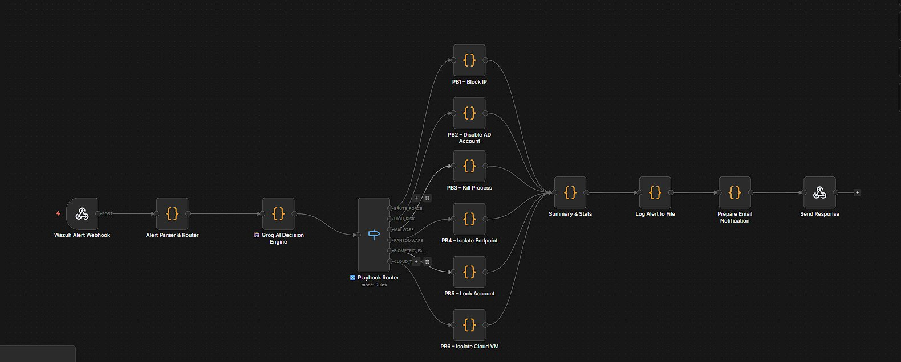

# n8n SOAR workflow: SOCPilot Groq v4.3

## Pipeline

| Step | Node | Type | Role |
|---|---|---|---|
| 1 | Wazuh Alert Webhook | Webhook | Entry point, `POST /webhook/wazuh-alert`. Receives the alert JSON from Wazuh (level ≥ 5). |
| 2 | Alert Parser & Router | Code (JS) | Normalises fields, computes a risk score, applies the 120 s per-IP cooldown. Source: [`code-nodes/alert-parser.js`](code-nodes/alert-parser.js). |
| 3 | Groq AI Decision Engine | HTTP Request | Calls the Groq chat-completions API and returns the structured verdict. |
| 4 | Playbook Router | Switch (mode: Rules) | Routes on the `playbook` field of the verdict. |
| 5 | PB1 … PB6 | Code | One branch per playbook (see the main [README](../README.md#playbooks)). |
| 6 | Summary & Stats | Code | Computes MTTR, number of actions, AI confidence. |
| 7 | Log Alert to File | Code | Persists the full incident as JSON. |
| 8 | Prepare Email Notification | Code | Builds the notification text. |
| 9 | Send Response | Telegram / HTTP | Sends the message through the Telegram Bot API. |

## Groq node settings

- URL: `https://api.groq.com/openai/v1/chat/completions`
- Model: `llama-3.3-70b-versatile`
- Temperature: `0.1`
- System prompt: [`prompts/soc-analyzer.system.txt`](prompts/soc-analyzer.system.txt)
- User message: the alert context (description, Wazuh level, rule groups, source IP, agent name, raw log excerpt)
- API key: store it as an **n8n credential**, never inline in the node

## Fallback when the API is unavailable

If the Groq call fails (quota, network timeout), the workflow falls back to keyword rules on the Wazuh description: `brute force` or `authentication failed` → `BRUTE_FORCE`; `malware` or `virus` → `MALWARE`.

## Things to know

- Only **one** active workflow may listen on `/webhook/wazuh-alert`. Two active workflows on the same path conflict; deactivate the old one before activating a new version.
- The Switch node (mode *Rules*) replaced an earlier chain of IF nodes that raised version-compatibility errors.
- See [`workflows/README.md`](workflows/README.md) for how to export and sanitize the workflow JSON before committing it.
